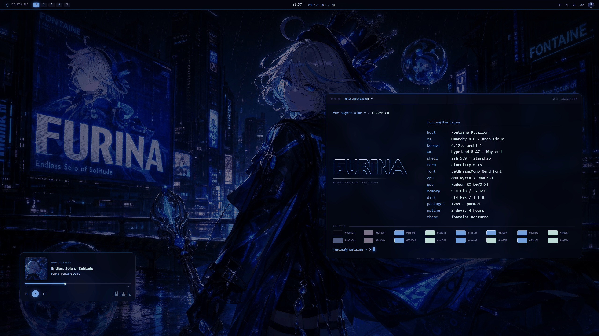
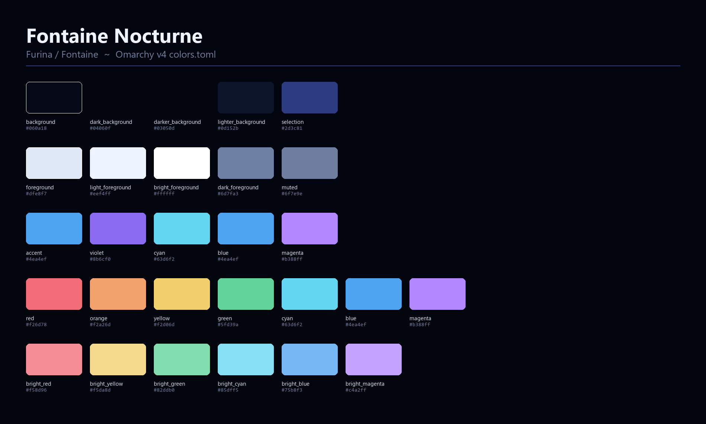
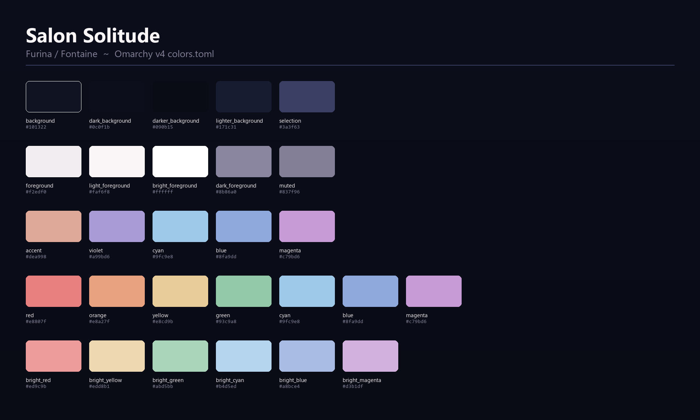

# Furina for Omarchy

Three Furina / Fontaine skins for [Omarchy](https://github.com/basecamp/omarchy) v4 (quattro) built on
one shared palette family: **fontaine-nocturne** (night rain over Fontaine), **hydro-iris** (crystal
hydro glass) and **salon-solitude** (rose-gold salon calm). Gradient window borders, a translucent
glass bar, three 2560x1440 wallpapers and palette-aware shell surfaces — installed with one
`omarchy theme install` command, no extra packages.



## The three skins

| Skin | Mood | Wallpaper | Accent | Default |
| --- | --- | --- | --- | --- |
| `fontaine-nocturne` | Fontaine at night in the rain: neon billboards, wet asphalt, indigo sky | `0-fontaine-nocturne.jpg` | hydro blue `#4ea4ef` | yes (`furina-omarchy`) |
| `hydro-iris` | Crystal hydro iris: electric blue, glass, near-black | `1-hydro-iris.jpg` | crystal blue `#5fb4ff` | optional (`furina-hydro-iris`) |
| `salon-solitude` | Salon light, soft face, quiet solitude: rose-gold, lavender, warm skin | `2-salon-solitude.jpg` | rose gold `#dea998` | optional (`furina-salon-solitude`) |

`omarchy theme install` gives you the first skin; the other two are one script away
(see [The other two skins](#the-other-two-skins)).

## Install

```sh
omarchy theme install https://github.com/TanPass/furina-omarchy
```

The installer clones the repo into `~/.config/omarchy/themes/furina-omarchy`, stages it, renders every
Omarchy template from `colors.toml` and activates it. No root, no extra dependencies, nothing outside
your config directory.

After activation:

- the theme name is `furina-omarchy` (the installer derives it from the repo URL);
- `colors.toml` drives every template Omarchy ships — Alacritty, foot, Ghostty, Kitty, btop, Helix,
  Hyprland borders, tmux, waybar, notifications and the rest;
- `shell.toml` replaces the generated shell config with the hand-tuned version described below;
- the first wallpaper in the rotation is `0-fontaine-nocturne.jpg`.

To pick a different skin later, use the theme switcher in the Omarchy menu or
`omarchy-theme-set furina-omarchy`. To update, run the install command again.

## Wallpapers

The pack ships all three wallpapers inside the theme, numbered so the picker order is deterministic:

```text
backgrounds/
  0-fontaine-nocturne.jpg   fontaine-nocturne skin
  1-hydro-iris.jpg          hydro-iris skin
  2-salon-solitude.jpg      salon-solitude skin
```

- **Cycle them:** `omarchy theme bg next` moves to the next wallpaper in the sorted list and wraps
  around, so one keypress walks nocturne → hydro iris → salon solitude → nocturne.
- **Pick any image:** open Omarchy's background picker from the Appearance menu (the same image
  carousel the theme ships as `[image-picker]` in `shell.toml`); it lists every image the theme and
  your overlay directory provide.
- **Per-theme overlay:** drop your own images into `~/.config/omarchy/backgrounds/<theme-name>/` —
  for this pack that is `~/.config/omarchy/backgrounds/furina-omarchy/`. Files there join the
  rotation for this theme only and leave the shipped wallpapers untouched. The live choice is
  symlinked at `~/.local/state/omarchy/current/background`.
- **Intro videos:** Omarchy also accepts silent 5–7 s clips in `backgrounds/intros/` next to a
  wallpaper of the same name; this pack ships none, but you can add your own in the overlay.

## The other two skins

Each variant is a complete standalone theme: its own `colors.toml`, `shell.toml` and its matching
wallpaper. Install them next to the default theme:

```sh
./scripts/install-variants.sh                 # all three skins
./scripts/install-variants.sh hydro-iris      # just one
omarchy-theme-set furina-hydro-iris           # switch to it
```

The script is idempotent, needs no root, writes only to
`${XDG_CONFIG_HOME:-$HOME/.config}/omarchy/themes/furina-<skin>` and copies the matching wallpaper
plus the lock-screen/preview art. Remove them again with:

```sh
./scripts/uninstall-variants.sh               # keeps the active theme
./scripts/uninstall-variants.sh --force       # also removes the active one
```

Prefer to do it by hand? Create `~/.config/omarchy/themes/furina-<skin>/backgrounds/` first, then copy
`variants/<skin>/colors.toml`, `variants/<skin>/shell.toml` and the wallpaper named in
`variants/<skin>/background` into it, and activate it with `omarchy-theme-set furina-<skin>`. Everything except the three wallpapers is palette data, so the
variants always follow the same Omarchy templating as the default skin.

| Installed theme | Skin | Comes from |
| --- | --- | --- |
| `furina-omarchy` | `fontaine-nocturne` | `omarchy theme install` |
| `furina-fontaine-nocturne` | `fontaine-nocturne` | `scripts/install-variants.sh` (same skin, handy name for scripting) |
| `furina-hydro-iris` | `hydro-iris` | `scripts/install-variants.sh` |
| `furina-salon-solitude` | `salon-solitude` | `scripts/install-variants.sh` |

## Palettes

All three skins share the Fontaine base (indigo ink surfaces, hydro blue, pale ice, warm bronze) and
differ in accent temperature. The full `colors.toml` files live in the repo root and in
`variants/<skin>/`.

### fontaine-nocturne — night rain



| Role | Key | Value |
| --- | --- | --- |
| background | `background` | `#060a18` |
| deep background | `darker_background` | `#03050d` |
| surface | `lighter_background` | `#0d152b` |
| body text | `foreground` | `#dfe8f7` |
| muted text | `muted` | `#6f7e9e` |
| accent (hydro) | `accent` | `#4ea4ef` |
| violet billboard | `violet` | `#8b6cf0` |
| rain cyan | `cyan` | `#63d6f2` |
| warm window light | `brown` | `#937562` |
| selection | `selection` | `#2d3c81` |

### hydro-iris — crystal hydro


| Role | Key | Value |
| --- | --- | --- |
| background | `background` | `#040612` |
| deep background | `darker_background` | `#01030a` |
| surface | `lighter_background` | `#0a1229` |
| body text | `foreground` | `#edf5ff` |
| muted text | `muted` | `#707e9d` |
| accent (crystal) | `accent` | `#5fb4ff` |
| violet | `violet` | `#8367ff` |
| cyan | `cyan` | `#8fe8ff` |
| warm bronze | `brown` | `#937562` |
| selection | `selection` | `#243a86` |

### salon-solitude — rose-gold calm



| Role | Key | Value |
| --- | --- | --- |
| background | `background` | `#101322` |
| deep background | `darker_background` | `#090b15` |
| surface | `lighter_background` | `#171c31` |
| body text | `foreground` | `#f2edf0` |
| muted text | `muted` | `#837f96` |
| accent (rose gold) | `accent` | `#dea998` |
| lavender | `violet` | `#a99bd6` |
| hydro (secondary blue) | `blue` | `#8fa9dd` |
| warm gold | `brown` | `#d9b48f` |
| selection | `selection` | `#3a3f63` |

### One deliberate deviation

The source palette sheet gives `muted` as `#4a5a80` / `#46567c` / `#5e5a78`; on these backgrounds that
is only 2.8–2.9:1, well below the pack's 4.5:1 readability target for secondary text. The shipped
`muted` value is lifted 25% toward `foreground` (the smallest change that clears 4.5:1) and every other
palette value is the source value unchanged.

| Skin | Source `muted` | Shipped `muted` | Contrast on background |
| --- | --- | --- | --- |
| fontaine-nocturne | `#4a5a80` | `#6f7e9e` | 4.84:1 |
| hydro-iris | `#46567c` | `#707e9d` | 4.96:1 |
| salon-solitude | `#5e5a78` | `#837f96` | 4.78:1 |

Body text stays far above the bar (15.9:1, 18.4:1, 15.9:1) and the accent picks stay at 7.4:1,
9.1:1 and 9.0:1, so links and prompts remain readable as text in every skin.

## What the theme ships

```text
furina-omarchy/
├── colors.toml                 default skin palette (fontaine-nocturne)
├── shell.toml                  hand-tuned shell config (gradient borders, glass bar)
├── preview.png                 2560x1440 desktop preview
├── preview-unlock.png          1920x1080 lock-screen preview
├── unlock.png                  1108x523 theme-switcher tile
├── backgrounds/                the three wallpapers, numbered for `theme bg next`
├── variants/
│   ├── fontaine-nocturne/      colors.toml, shell.toml, background
│   ├── hydro-iris/             colors.toml, shell.toml, background, preview art
│   └── salon-solitude/         colors.toml, shell.toml, background, preview art
├── scripts/
│   ├── install-variants.sh
│   └── uninstall-variants.sh
├── tools/
│   └── validate.mjs            installability validator (no dependencies)
└── docs/                       palette cards used by this README
```

The three previews are the sizes Omarchy's theme switcher and lock screen expect: 2560x1440 desktop,
1920x1080 lock screen, 1108x523 theme-switcher tile.

Everything a cloned theme is allowed to ship: palette data, wallpapers, previews and a hand-written
`shell.toml`. No symlinks, no `*.lua`, no terminal configs that Omarchy generates itself
(`INSTALLED_THEME_DENIED`), so the staged theme is exactly what the templates expect.

## What `shell.toml` changes

Omarchy's generated `shell.toml` is good; this pack overrides it with a static file that only uses
documented v4 keys:

- **Gradient borders.** `[hyprland].active-border` is the two-stop hydro → violet gradient at 35°
  (`rgba(4ea4efee) rgba(8b6cf0ee) 35deg`), and every popup / launcher / lock border references it, so
  windows, menus and the lock screen share one light direction.
- **Glass bar.** `[bar].background-alpha` drops to `0.84` with a 28 px horizontal / 30 px vertical bar
  and the font-scaled sizing kept from the default, so the wallpaper reads through the top bar without
  hurting legibility.
- **Translucent surfaces.** Popups `0.88`, launcher and menu `0.90`, notifications `0.92`, lock screen
  `0.75`, each with a slightly stronger border alpha so the rounded edges stay crisp.
- **Roomier spacing.** `[spacing]` opens control gaps, paddings and popup row heights for the wider
  gradient borders, and `[font].base-size` stays at 12 so nothing grows past the stock layout.
- **Consistent selection.** Launcher/menu selection uses the palette `selection` colour, selected text
  uses `accent`, and `[image-picker]` matches so the wallpaper carousel looks at home.

## Validation

```sh
node tools/validate.mjs
```

The validator reads the local Omarchy source (`bin/omarchy-theme-set`,
`bin/omarchy-theme-install`, `default/themed/*.tpl`) and re-implements the installer's rules instead of
trusting the pack:

1. repo shape and theme naming — the README URL must resolve to `furina-omarchy` under
   `omarchy-theme-install`'s own algorithm;
2. clone filter — no `*.lua`, no `INSTALLED_THEME_DENIED` files, no symlinks anywhere;
3. palettes — every key present and valid, `mode = "dark"`, WCAG contrast targets for all four
   `colors.toml` files (root + three variants);
4. `shell.toml` — every section and key exists in `shell.toml.tpl`, types and alpha ranges hold,
   colors agree with `colors.toml`, the gradient border is really the accent → violet pair;
5. preview art — exact dimensions and 16:9 shape, and no leftover development art;
6. wallpapers — three 2560x1440 JPEGs in deterministic `theme bg next` order;
7. variants and scripts — variant payloads complete, scripts POSIX and safe;
8. **template rendering** — all 23 built-in templates rendered for all four palettes with Omarchy's
   token / `_rgb` / `_strip` / `mix` / `hypr_gradient` rules, asserting zero `{{ }}` tokens
   survive;
9. staging — the theme that would land in `~/.local/state/omarchy/current/theme` is complete and does
   not accidentally override a generated config;
10. docs and encoding — README commands and images resolve, LICENSE present, LF line endings.

Expected result: `RESULT: PASS`, exit code 0. Rendering uses the local reference copies, so validation
works offline.

## Fan art, credits and licence

The theme files, templates and scripts in this repository are released under the MIT licence (see
`LICENSE`). Furina is a character from *Genshin Impact*, © HoYoverse / COGNOSPHERE; the wallpapers,
preview mockups and palette names here are **fan art** made for personal desktop use, not affiliated
with or endorsed by HoYoverse. Please do not sell the art or the pack as official merchandise.

Built for [Omarchy](https://github.com/basecamp/omarchy) by DHH and the Omarchy community — the install
flow, `colors.toml` schema and `shell.toml` surface are theirs; this pack is just palette data and a
little taste on top.
